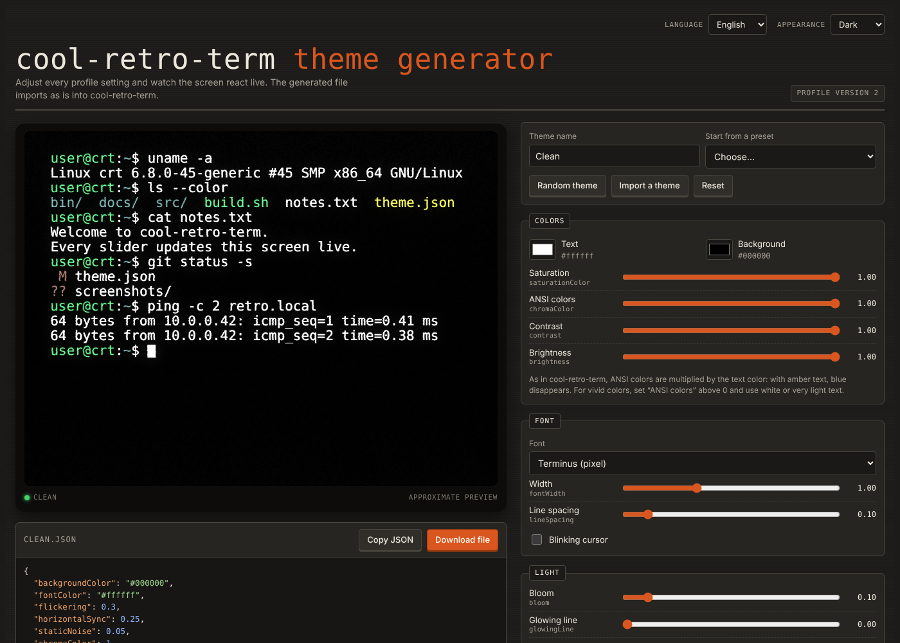

# cool-retro-term theme generator

A live theme generator for [cool-retro-term](https://github.com/Swordfish90/cool-retro-term), the terminal emulator that mimics old cathode-ray screens.
Tweak every profile setting, watch the CRT effects update in real time, then export a `.json` file ready to import.

**Live demo:** https://fredericamella.github.io/cool-retro-term-theme-generator/

[English](#english) · [Français](#français) · [Deutsch](#deutsch)

---

## English

### Features
- Real-time WebGL preview: bloom, glowing line, burn-in, static noise, flickering, horizontal sync, jitter, RGB shift, curvature, rasterization, frame and window opacity.
- Text colors computed with the same formula as cool-retro-term's shader (`terminal_dynamic.frag`), so ANSI colors look as they will in the terminal.
- Every key of the current profile format (version 2), with a `rbgShift` copy for older 1.2.x releases.
- Built-in cool-retro-term presets and themes from the community wiki as starting points, plus a random theme button.
- Import any existing theme (pasted JSON or `.json` file).
- Interface in English, French and German, with light, dark or system appearance.
- A single static HTML file: no build step, no server, no tracking. Settings are kept in your browser's local storage.

### Use it
Open the [live demo](https://fredericamella.github.io/cool-retro-term-theme-generator/), or download `index.html` and open it in any recent browser.
An internet connection is only needed for the web fonts used in the preview.

### Install a generated theme
1. In cool-retro-term, right-click and open **Settings**.
2. In the **General** tab, profiles section, click **Import** and choose the `.json` file.
3. Select the imported profile and click **Load**.

You can also start the terminal with it: `cool-retro-term --profile "My theme"`.

### Getting real colors
cool-retro-term multiplies ANSI colors by the theme's text color. With amber text, blue output turns black. For vivid colors, set **Chroma Color** above 0 (ideally 1) and use a white or very light text color. With Chroma Color at 0, the terminal renders in monochrome.

### Limits
The preview is an approximation: the original bitmap fonts are replaced by close web fonts, and the effects are re-implemented rather than copied from the original shaders.

---

## Français

Générateur de thèmes pour cool-retro-term avec aperçu en direct. Réglez chaque paramètre du profil, l'écran réagit immédiatement, puis téléchargez le fichier `.json`.

**Installation d'un thème :** dans cool-retro-term, clic droit puis **Settings**, onglet **General**, bouton **Import**, puis **Load** sur le profil importé.

**Couleurs :** cool-retro-term multiplie les couleurs ANSI par la couleur du texte. Pour des couleurs franches, réglez **Chroma Color** au-dessus de 0 et choisissez un texte blanc ou très clair.

L'interface est disponible en français, anglais et allemand, en mode clair, sombre ou selon le système.

---

## Deutsch

Theme-Generator für cool-retro-term mit Live-Vorschau. Jede Profileinstellung anpassen, die Vorschau reagiert sofort, dann die `.json`-Datei herunterladen.

**Theme installieren:** In cool-retro-term rechts klicken, **Settings**, Reiter **General**, **Import**, dann das importierte Profil mit **Load** laden.

**Farben:** cool-retro-term multipliziert ANSI-Farben mit der Textfarbe. Für kräftige Farben **Chroma Color** über 0 setzen und weißen oder sehr hellen Text wählen.

---

## Credits and references

This project is an independent companion tool. It is not affiliated with the cool-retro-term project.

- **cool-retro-term** by Filippo Scognamiglio ([@Swordfish90](https://github.com/Swordfish90)), GPL-3.0: https://github.com/Swordfish90/cool-retro-term
- Profile format and built-in presets: [`app/qml/ApplicationSettings.qml`](https://github.com/Swordfish90/cool-retro-term/blob/master/app/qml/ApplicationSettings.qml)
- Color formula: [`app/shaders/terminal_dynamic.frag`](https://github.com/Swordfish90/cool-retro-term/blob/master/app/shaders/terminal_dynamic.frag)
- Community themes: [Third Party Themes wiki page](https://github.com/Swordfish90/cool-retro-term/wiki/Third-Party-Themes), each theme credited to its author there
- Preview fonts from [Google Fonts](https://fonts.google.com): VT323, Press Start 2P, IBM Plex Mono and Sans, Fira Code, JetBrains Mono, Inconsolata, Share Tech Mono, Source Code Pro

## License

[GPL-3.0](LICENSE), the same license as cool-retro-term.

## Author

**cool-rétro-term theme generator v1.0 - Frédéric AMELLA**
[github.com/fredericamella](https://github.com/fredericamella)
